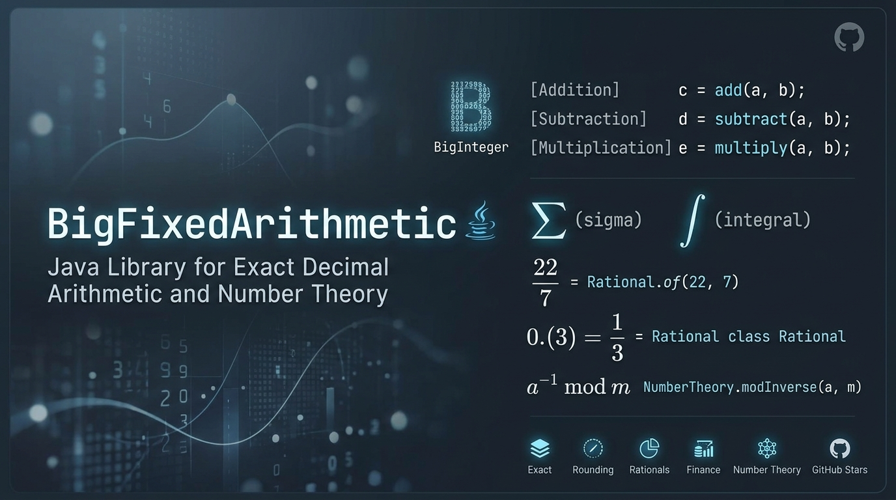

# BigFixedArithmetic

Exact arithmetic in a single Java file, built on `BigInteger`. It parses numbers from strings (including scientific notation) without losing a digit, divides exactly (repeating decimals are detected and shown as `0.(3)`), and includes a `Rational` fraction type, a `Number` subclass, with features `BigDecimal` doesn't have: repeating-decimal parsing, cycle analysis, expansion in any base, continued fractions, best approximations, correctly rounded square roots, nth roots and fractional powers, and bounded-precision contexts that stop fractions growing without limit.

## Features

**Arithmetic and parsing**
- Exact addition, subtraction and multiplication (Russian Peasant) at any size, with no overflow.
- Decimal strings parsed exactly (`parseDecimal`, `parseInteger`), including scientific notation: `"-12.375"` is held as `-12375` with 3 decimal places and `"1.5e3"` as `1500`.
- Exact `Decimal` add, subtract and multiply.

**Division**
- **Exact mode** gives the complete result. A repeating expansion is written with its repeating block in parentheses: `1/3 = 0.(3)`, `1/6 = 0.1(6)`, `22/7 = 3.(142857)`. It always terminates, emits digits as they are computed, and uses constant memory.
- **Fixed-places mode** rounds to the places you ask for, using any `java.math.RoundingMode` (default `HALF_UP`).
- Both modes work in **any base from 2 to 36**: `1/3` is `0.1` in base 3 and `1/10` is `0.0(0011)` in base 2.

**`Rational`: an exact fraction type (a `Number` subclass)**
- Lowest-terms `BigInteger` fractions with `add`, `subtract`, `multiply`, `divide`, `pow`, `negate`, `reciprocal`.
- **`Number` conversions:** `intValue`, `longValue`, `floatValue` and `doubleValue`. The float and double results are correctly rounded (ties to even), including subnormals and overflow to infinity. `Decimal` is a `Number` too.
- **Exact comparison** (`compareTo`, `equals`) that works even for values with no finite decimal form.
- **Floor, ceiling, truncate and rounding** (`round(mode)`), plus `roundToDenominator(n, mode)` to round to the nearest 1/n, for example the nearest sixteenth.
- **Parsing** of integers, decimals, scientific notation (`1.5e3`), repeating decimals (`0.(3)`, `0.1(6)`, `0.(3)e2`), fractions (`22/7`, `1.5/0.25`) and mixed numbers (`3 1/7`, `-3 1/7`), all exactly. `parse(text, base)` reads positional notation in any base.
- **Scientific and engineering output**, either rounded to a number of significant digits or exact: `1.2346E+4`, `12.346E+3`.
- **Bounded precision** through `Rational.Context`: limit results to N significant digits, N decimal places, or a maximum denominator, so chained arithmetic doesn't grow without limit.
- **Square roots, nth roots and powers** (`sqrt`, `root`, `pow`) with integer or fractional exponents, correctly rounded to the precision you choose.
- **Cycle analysis**: `preperiodLength()` and `periodLength()` (any base) report how many digits come before the repeating block and how long the block is, without generating digits.
- **Expansion in any base** with `toRadixString(base, places, mode)`, plus `toDecimalString` and `toRepeatingString`.
- **Continued fractions**: `continuedFraction()`, `convergents()`, `fromContinuedFraction(...)`.
- **Approximation**: `bestApproximation(maxDenominator)` finds the closest fraction with a limited denominator (pi to many digits with a limit of 1000 gives `355/113`). `approximate(x, tolerance)` and `fromDecimal(text)` recover the simplest fraction from a rounded value (`"0.142857"` gives `1/7`).
- **Formatting**: mixed numbers (`3 1/7`) and Egyptian fractions (`4/13 = 1/4 + 1/18 + 1/468`).

No dependencies beyond the JDK.

## When to use BigFixedArithmetic (and when to use BigDecimal first)

> **Caveat: consider `java.math.BigDecimal` first.** `BigDecimal` is part of the JDK, is heavily optimised, is understood by every Java developer, and is supported by JDBC, JSON libraries, frameworks and tooling. For most scientific and financial code it is the right choice, and it is much faster than this library. Reach for `BigFixedArithmetic` only when you hit a limit that `BigDecimal` cannot meet, and measure the speed cost before committing to it.

### Financial applications

`BigDecimal` is enough for most money handling: prices, invoices, interest at a fixed scale, tax with a defined rounding rule. `BigFixedArithmetic` is a better fit when:

- **Division must be exact.** `BigDecimal.divide` throws for `1/3` unless you pick a rounding. Here `1/3` is kept as the fraction `1/3` and prints as `0.(3)`, so splitting a payment three ways and recombining gives exactly the original amount, with no cent lost.
- **Rates and ratios must stay exact through a chain of calculations.** Currency conversion, pro-rata allocation, day-count fractions (such as 31/365) and compound factors can be carried as `Rational` values and rounded once, at the end, with the rounding mode you choose.
- **You need an audit trail.** Exact fractions and exact decimal output let you show that a result is not an accumulation of rounding errors, and `Context` lets you state the rounding point explicitly.
- **You must reconcile in several bases or formats**, or need the repeating pattern of a quotient (`periodLength()`, `toRepeatingString()`).

Keep using `BigDecimal` for storage and interchange (database columns, APIs, reports), and convert at the edges: `Rational.parse(bigDecimal.toPlainString())` in, `toDecimalString(places, mode)` out.

### Scientific applications

`BigDecimal` is enough when you need a fixed number of digits more than `double` provides and your operations are add, subtract, multiply and divide with a `MathContext`. `BigFixedArithmetic` is a better fit when:

- **You need exact rational results** such as ratios, rational approximations, unit conversions with exact factors, or the exact value of a repeating expansion that `BigDecimal` can only truncate.
- **You need correctly rounded roots and fractional powers.** `sqrt`, `root` and `pow` with a `Rational` exponent are rounded once from the true value, to the digits, places or denominator limit you set. (`BigDecimal.sqrt` exists from Java 9, but there are no nth roots or fractional powers.)
- **You need number-theory style tools**: continued fractions and convergents, best rational approximation with a bounded denominator, cycle analysis (preperiod and period lengths in any base), and expansion in bases 2 to 36.
- **Results must be reproducible and independent of binary floating point**, including exact `doubleValue()` and `floatValue()` conversions for comparing against `double` code.
- **You want to prove or test a claim**, for example checking a floating-point result against the exact answer.

### Where BigDecimal is the better choice

- Performance matters. This library multiplies and divides the long way, and `Rational` normalises to lowest terms after every operation.
- You only need decimal numbers at a fixed or limited scale, which is what `BigDecimal` was designed for.
- You need to interoperate with libraries, databases or serialisation formats that expect `BigDecimal`.
- You need transcendental functions (sine, logarithm, exponential, pi). Neither class provides them as exact values, and this library does not include them.

## Requirements

Java 11 or later (the single-file source launcher is used below).

## Build and run

```bash
javac BigFixedArithmetic.java
java BigFixedArithmetic
```

Or, without a separate compile step:

```bash
java BigFixedArithmetic.java
```

Example session (exact mode):

```
=== BigFixedArithmetic Demo ===
Numbers may be integers, decimals or scientific notation, e.g. 42, -0.5, 3.14159, 1.5e3
Enter Dividend / First Operand: 355
Enter Divisor / Second Operand: 113

--- Basic Operations ---
Addition (a + b)       : 468
Subtraction (a - b)    : 242
Multiplication (a * b) : 40115

--- Division ---
Enter required decimal places (-1 for exact, repeating blocks shown like 0.(3)): -1
Division Result (a / b): 3.(1415929203539823008849557522123893805309734513274336283185840707964601769911504424778761061946902654867256637168)

--- Exact Fraction Forms of a / b ---
Fraction           : 355/113
Mixed number       : 3 16/113
Continued fraction : [3; 7, 16]
Scientific (10 sig): 3.141592920E+0
Square root (30 sig): 1.77245392615830279609194647606E+0
```

Choosing a number of places instead rounds the result: `2 / 3` to 5 places with `HALF_UP` prints `0.66667`.

## Using it as a library

Copy `BigFixedArithmetic.java` into your project. The examples below use a shorthand `Rational` for `BigFixedArithmetic.Rational` and `Context` for `BigFixedArithmetic.Rational.Context`.

### Division

```java
import java.math.BigInteger;
import java.math.RoundingMode;

BigInteger one = BigInteger.ONE, three = BigInteger.valueOf(3), six = BigInteger.valueOf(6);

BigFixedArithmetic.divideToString(one, three, -1, RoundingMode.HALF_UP);   // "0.(3)"
BigFixedArithmetic.divideToString(one, six,   -1, RoundingMode.HALF_UP);   // "0.1(6)"
BigFixedArithmetic.divideToString(BigInteger.TWO, three, 5, RoundingMode.HALF_UP);  // "0.66667"
BigFixedArithmetic.divideToString(BigInteger.TWO, three, 5, RoundingMode.DOWN);     // "0.66666"

// Other bases
BigFixedArithmetic.divideToString(one, three, -1, RoundingMode.HALF_UP, 3);          // "0.1"
BigFixedArithmetic.divideToString(one, BigInteger.TEN, -1, RoundingMode.HALF_UP, 2); // "0.0(0011)"
```

### Rational

```java
Rational third = Rational.parse("1/3");

// Exact arithmetic: no rounding anywhere
third.multiply(Rational.of(3));                    // 1
Rational.parse("0.1").add(Rational.parse("0.2")); // 3/10

// Parsing every form
Rational.parse("0.(3)");          // 1/3
Rational.parse("0.1(6)");         // 1/6
Rational.parse("3.(142857)");     // 22/7
Rational.parse("-3 1/7");         // -22/7
Rational.parse("1.5/0.25");       // 6
Rational.parse("1.5e3");          // 1500
Rational.parse("2.5E-3");         // 1/400
Rational.parse("0.(3)e2");        // 100/3
Rational.parse("0.(0011)", 2);    // 1/5, read in base 2

// Exact comparison, floor, ceiling and rounding
Rational x = Rational.of(-22, 7);
x.floor();                                           // -4
x.ceil();                                            // -3
x.round(RoundingMode.HALF_UP);                       // -3
x.roundToDenominator(16, RoundingMode.HALF_UP);      // -25/8 (nearest sixteenth)

// Cycle information
Rational.of(1, 7).periodLength();                    // 6
Rational.of(1, 12).preperiodLength();                // 2  (0.08(3))

// Any base
Rational.of(1, 10).toRadixString(2, -1, RoundingMode.HALF_UP);   // "0.0(0011)"

// Continued fractions and approximation
Rational r = Rational.of(355, 113);
r.toContinuedFractionString();                       // "[3; 7, 16]"
r.convergents();                                     // [3, 22/7, 355/113]
Rational.parse("3.14159265358979323846").bestApproximation(1000);   // 355/113
Rational.fromDecimal("0.142857");                    // 1/7

// Formatting
Rational.of(22, 7).toMixedString();                  // "3 1/7"
Rational.of(4, 13).toEgyptianString();               // "1/4 + 1/18 + 1/468"
```

### Number conversions

```java
Number n = Rational.parse("7/2");
n.intValue();                                        // 3
n.doubleValue();                                     // 3.5
Rational.parse("1/3").doubleValue();                 // 0.3333333333333333 (correctly rounded)
BigFixedArithmetic.parseDecimal("-12.375").doubleValue();   // -12.375
```

`intValue()` and `longValue()` drop the fractional part and narrow like `BigInteger` does. `floatValue()` and `doubleValue()` are the nearest value, and become infinite or zero when the number is out of range.

### Scientific and engineering notation

```java
Rational v = Rational.parse("12345.678");
v.toScientificString(5, RoundingMode.HALF_UP);       // "1.2346E+4"
v.toEngineeringString(5, RoundingMode.HALF_UP);      // "12.346E+3"
Rational.parse("0.125").toScientificString();        // "1.25E-1"  (exact, fewest digits)
Rational.parse("12500").toEngineeringString();       // "12.5E+3"
BigFixedArithmetic.parseDecimal("12345.6").toEngineeringString();   // "12.3456E+3"
```

The digit-count versions always print exactly that many significant digits, trailing zeros included (`1/4` with 5 digits is `2.5000E-1`). The exact versions print the fewest digits that represent the value, and throw `ArithmeticException` if the decimal expansion doesn't terminate (use the digit-count version for those). Zero is `0E+0`.

### Bounded precision

A `Context` limits a result in the way `MathContext` limits a `BigDecimal`:

```java
Context.significantDigits(5)                    // 5 significant digits, HALF_UP
Context.significantDigits(5, RoundingMode.DOWN)
Context.decimalPlaces(2)                        // 2 places after the point
Context.maxDenominator(100)                     // nearest fraction with denominator <= 100
Context.UNLIMITED                               // no limit, results stay exact
```

Pass one to the arithmetic methods, or call `ctx.apply(x)` on any value:

```java
Rational.of(22, 7).add(Rational.of(1, 3), Context.significantDigits(5));   // 3.4762
Rational.of(22, 7).multiply(Rational.of(1, 3), Context.decimalPlaces(2));  // 1.05
Rational.of(2).pow(10, Context.significantDigits(2));                      // 1000
Rational.of(1, 3).roundToSignificantDigits(3, RoundingMode.HALF_UP);       // 0.333
Rational.of(1, 3).roundToDecimalPlaces(4, RoundingMode.HALF_UP);           // 0.3333
```

This is what keeps iterative calculations small. Newton's method for the square root of 2 with exact fractions roughly doubles the size of the fraction every step; with `Context.significantDigits(30)` after each operation it stays at a fixed size.

### Square roots, nth roots and powers

```java
Rational.parse("9/4").sqrt();                              // 3/2 (exact; throws if the root is irrational)
Rational two = Rational.of(2);
two.sqrt(Context.significantDigits(20));                   // 1.4142135623730950488
two.sqrt(Context.maxDenominator(100));                     // 140/99
two.root(3, Context.significantDigits(10));                // 1.25992105 (cube root)
Rational.of(-8).root(3, Context.UNLIMITED);                // -2 (odd roots of negatives are real)

// Powers with integer or fractional exponents
Rational.of(8).pow(Rational.parse("2/3"));                 // 4
Rational.of(1, 4).pow(Rational.parse("-1/2"));             // 2
two.pow(Rational.parse("1/2"), Context.significantDigits(10));   // 1.414213562
Rational.of(-8).pow(Rational.parse("1/3"));                // -2
```

Roots and fractional powers are **correctly rounded**: the result is the true value rounded as the context says, never an approximation that is rounded a second time. A rational result (such as `3/2` for `9/4`) is returned exactly and then limited by the context. If the true result is irrational and the context is `UNLIMITED`, an `ArithmeticException` is thrown, because no finite fraction is exact.

`hasRationalRoot(n)` tells you in advance whether the nth root is rational.

### Number theory

The nested `NumberTheory` class collects number-theory tools. It uses `BigInteger`'s own fast multiply, mod and gcd rather than the long-hand routines, because factorisation and modular exponentiation are impractical otherwise. Fractional results come back as exact `Rational` values.

```java
import java.math.BigInteger;
import BigFixedArithmetic.NumberTheory;   // the nested class; Rational is BigFixedArithmetic.Rational

NumberTheory.extendedGcd(BigInteger.valueOf(240), BigInteger.valueOf(46));  // gcd=2, x=-9, y=47
NumberTheory.modInverse(BigInteger.valueOf(3), BigInteger.valueOf(10));     // 7 (any modulus, not only primes)
NumberTheory.crt(new BigInteger[]{BigInteger.TWO, BigInteger.valueOf(3)},
                 new BigInteger[]{BigInteger.valueOf(3), BigInteger.valueOf(5)});   // x = 8 (mod 15)

NumberTheory.factorizationString(BigInteger.valueOf(600));                  // "2^3 * 3 * 5^2"
NumberTheory.factorize(new BigInteger("1000000007").multiply(new BigInteger("998244353")));
NumberTheory.eulerPhi(BigInteger.valueOf(36));                              // 12
NumberTheory.multiplicativeOrder(BigInteger.TEN, BigInteger.valueOf(7));    // 6 (the period of 1/7)
NumberTheory.primitiveRoot(BigInteger.valueOf(41));                         // 6

NumberTheory.fareySequence(5);                                              // 0, 1/5, 1/4, 1/3, 2/5, 1/2, ...
NumberTheory.sternBrocotPath(Rational.of(5, 3));                            // "RLR"
NumberTheory.pell(BigInteger.valueOf(61));                                  // {1766319049, 226153980}

NumberTheory.bernoulli(12);                                                 // -691/2730
NumberTheory.harmonic(10);                                                  // 7381/2520
NumberTheory.sumOfPowers(3, BigInteger.valueOf(100));                       // 25502500
```

| Group | Methods |
|---|---|
| gcd and inverses | `extendedGcd(a, b)`, `modInverse(a, m)`, `gcd` / `lcm` of integers or rationals (also with any number of arguments) |
| Congruences | `crt(residues, moduli)`; the moduli need not be coprime, and an inconsistent system throws `ArithmeticException` |
| Primes | `isPrime` (exact below about 3.3e24, a 64-round probable-prime test above that), `nextPrime` |
| Factorisation | `factorize(n)` (map of prime to exponent, increasing), `factorizationString(n)`; trial division, then Pollard-Brent rho |
| Arithmetic functions | `eulerPhi`, `divisorCount`, `divisorSum(n, k)`, `mobius`, `radical`, `divisors`, `carmichaelLambda` |
| Orders and roots | `multiplicativeOrder(a, m)`, `primitiveRoot(p)` |
| Farey and Stern-Brocot | `fareySequence(n)`, `fareyNeighbours(r, n)`, `mediant`, `areFareyNeighbours`, `sternBrocotPath(r)`, `fromSternBrocotPath(path)` |
| Pell equations | `pell(n)` (fundamental solution of x^2 - n y^2 = 1), `sqrtContinuedFraction(n)` |
| Exact series | `bernoulli(n)` (B1 = -1/2), `harmonic(n)`, `sumOfPowers(k, n)` (Faulhaber) |

Limits: `factorize` is quick when the second-smallest prime factor is below about 12 digits and can take minutes to hours when n has two prime factors of 17 digits or more (2^128+1 did not finish in several minutes); `fareySequence` is limited to n of 20000; `bernoulli` and `sumOfPowers` are limited to index 20000; `sternBrocotPath` refuses paths longer than ten million steps.

### Finance: allocating money without losing a cent

The nested `Finance` class splits an amount in proportion to weights so that the parts add back to exactly the original amount, with no cent lost or invented. This is the case where `BigDecimal` division forces you to round each share and then patch the total by hand.

```java
import BigFixedArithmetic.Finance;
import BigFixedArithmetic.Finance.Remainder;

Rational[] parts = Finance.allocateEvenly(Rational.of(100), 2, 3);   // 33.34, 33.33, 33.33 (as exact fractions)
Finance.sum(parts);                                                    // 100

// Proportional split: 70% / 20% / 10% of 0.05, in whole cents
Finance.allocate(Rational.parse("0.05"), 2,
                 Rational.of(70), Rational.of(20), Rational.of(10));   // 0.04, 0.01, 0.00

// A different rule for the leftover cents, and rational weights
Finance.allocate(Rational.parse("12.00"), 2, Remainder.FIRST,
                 Rational.of(1, 2), Rational.of(1, 3), Rational.of(1, 6));   // 6.00, 4.00, 2.00
```

- `allocate(amount, places, weights...)` and `allocate(amount, places, rule, weights...)` work in whole units of 10^-places (`places = 2` is cents).
- `allocateEvenly(amount, places, n)` splits into n equal shares; the first few are one unit larger when the amount does not divide evenly.
- `Remainder.LARGEST_REMAINDER` (the default) gives each leftover unit to the share with the largest fractional part, earlier shares first on ties, so no share is more than one unit from its exact value. `FIRST` and `LAST` give the leftover units one each to the first or last shares with a non-zero weight.
- A negative amount gives negative shares. A share with weight zero always gets zero.
- The amount must be an exact multiple of the unit (`allocate(1/300, 2, ...)` throws `ArithmeticException`), and weights must be non-negative and not all zero.
- `Finance.sum(values...)` adds exact values, for checking that an allocation reconciles.

### Engineering ratios

The nested `Engineering` class helps with the ratios found in electronics and signal work: picking integer multipliers and dividers for a clock or PLL, UART baud divisors, sample-rate conversion, resistor networks and E-series values, and fixed-point quantisation. Every error is reported exactly (as a fraction) and in parts per million.

```java
import BigFixedArithmetic.Engineering;

// Best ratio p/q with p and q both limited (here to 1000)
Engineering.bestRatio(Rational.parse("3.14159265358979"), 1000, 1000);       // 355/113 (error 0.08 ppm)

// Make 48 kHz from a 25 MHz reference with multiplier and divider limits of 4096
Engineering.synthesize(Rational.of(25_000_000), Rational.of(48_000), 4096, 4096);
                                                                              // x6 / 3125 = 48000 Hz (error 0 ppm)

// UART baud divisors (oversample 16): a 16 MHz clock cannot hit 115200 well, 11.0592 MHz can
Engineering.uartDivisor(Rational.of(16_000_000), 115200, 16, 65535);          // /9, error -35493.83 ppm
Engineering.uartDivisor(Rational.of(11_059_200), 115200, 16, 65535);          // /6 = 115200 Hz (error 0 ppm)

// Sample-rate conversion factors {up, down}
Engineering.sampleRateRatio(Rational.of(44100), Rational.of(48000));          // [160, 147]

// Resistors
Engineering.parallelResistance(Rational.of(10), Rational.of(20), Rational.of(30));   // 60/11, exactly
Engineering.nearestStandard(Rational.of(4800), 12);                           // 4700 (E12)
Engineering.bestStandardPair(Rational.parse("3.3"), 24);                      // R1=1, R2=33/10 (error 0 ppm)

// Fixed point: why 0.1 is not exact in binary
Rational.parse("0.1").toRadixString(2, -1, RoundingMode.HALF_UP);            // "0.0(0011)"
Engineering.quantise(Rational.parse("0.1"), 8, RoundingMode.HALF_EVEN);       // 26 / 2^8 = 13/128 (error 1/640)
Engineering.bitsNeeded(Rational.parse("0.1"), Rational.of(1, 1000));          // 9
```

| Group | Methods |
|---|---|
| Best ratios | `bestRatio(target, maxNumerator, maxDenominator)`, `convergentLadder(target, maxDenominator)`, `sampleRateRatio(from, to)` |
| Clocks and PLLs | `synthesize(reference, target, maxMultiplier, maxDivider)`, `integerDivider(source, target, maxDivisor)`, `uartDivisor(clock, baud, oversample, maxDivisor)` |
| Resistors | `seriesResistance`, `parallelResistance`, `voltageDivider(vin, r1, r2)`, `eSeries(n)`, `nearestStandard(value, series)`, `bestStandardPair(ratio, series)` |
| Fixed point | `quantise(value, fractionalBits, mode)`, `bitsNeeded(value, maxError)`, `isDyadic(value)` |

Notes:
- `bestRatio` tries every denominator up to the limit, so `maxDenominator` is capped at 10,000,000 (a million denominators takes about a third of a second). Ties go to the smaller denominator, and the result is always in lowest terms.
- `eSeries` supports E3, E6, E12, E24 (the published two-digit values) and E48, E96, E192 (10^(i/n) correctly rounded to three significant figures, using the library's own root function). The generated E48 and E96 lists were checked against the published tables.
- `bestStandardPair` returns `r1` as a value from 1.0 to under 10 and `r2` in whatever decade gives the best ratio; multiply both by the same power of ten to choose real resistances. Searching E192 takes about half a second.
- Dividers report the output frequency as an exact fraction, so a divide-by-9 of 16 MHz prints as 1000000/9 Hz.

### API summary

**Static arithmetic**

| Method | Description |
|---|---|
| `add`, `subtract`, `multiply` on `BigInteger` or `Decimal` | Exact results |
| `longDivide(BigInteger, BigInteger)` | Integer quotient of two non-negative values |
| `divideToString(dividend, divisor, places, mode[, base])` | Quotient as text |
| `streamDivide(dividend, divisor, places[, mode])` | Prints the quotient and a newline |
| `parseDecimal(String)` / `parseInteger(String)` | Exact string parsing, scientific notation included |
| `MAX_EXPONENT` | Largest accepted exponent (10,000) |

**`Rational`** (extends `Number`)

| Group | Methods |
|---|---|
| Create | `of(n, d)`, `of(n)`, `of(Decimal)`, `parse(text)`, `parse(text, base)`, `fromDecimal(text[, tolerance])`, `fromContinuedFraction(...)` |
| Arithmetic | `add`, `subtract`, `multiply`, `divide` (each with an optional `Context`), `pow`, `negate`, `abs`, `reciprocal`, `signum` |
| Roots and powers | `sqrt()`, `sqrt(ctx)`, `root(n, ctx)`, `pow(int[, ctx])`, `pow(Rational[, ctx])`, `hasRationalRoot(n)` |
| Precision | `Context.significantDigits`, `Context.decimalPlaces`, `Context.maxDenominator`, `Context.UNLIMITED`, `ctx.apply(x)`, `roundToSignificantDigits`, `roundToDecimalPlaces` |
| Number | `intValue`, `longValue`, `floatValue`, `doubleValue` |
| Compare | `compareTo`, `equals`, `isInteger` |
| Integer part | `floor`, `ceil`, `truncate`, `fractionalPart`, `round(mode)`, `roundToDenominator(n, mode)` |
| Cycles | `preperiodLength([base])`, `periodLength([base])` |
| Expansion | `toRadixString(base, places, mode)`, `toDecimalString(places, mode)`, `toRepeatingString()` |
| Scientific | `toScientificString([digits, mode])`, `toEngineeringString([digits, mode])` |
| Continued fractions | `continuedFraction()`, `toContinuedFractionString()`, `convergents()` |
| Approximation | `bestApproximation(maxDenominator)`, `approximate(x, tolerance)` |
| Formatting | `toString()`, `toMixedString()`, `egyptianFractions()`, `toEgyptianString()` |

### Division modes

| `places` | Behaviour |
|---|---|
| `-1` | Exact result. A repeating block is shown in parentheses, for example `0.1(6)`. The rounding mode is ignored. |
| `0` or more | Rounded to that many places with the given `RoundingMode` (default `HALF_UP`). A quotient that divides out exactly in fewer places is printed without padding zeros (`24.75`, not `24.750000`). |

Supported rounding modes are `UP`, `DOWN`, `CEILING`, `FLOOR`, `HALF_UP`, `HALF_DOWN`, `HALF_EVEN` and `UNNECESSARY` (which throws `ArithmeticException` if rounding would be needed). A result that rounds to zero is printed as `0`, never `-0`. In bases other than 10, `HALF_EVEN` looks at whether the last digit, in that base, is odd.

### Accepted input formats

`parseDecimal` and `parseInteger` accept an optional `+` or `-`, digits, at most one decimal point, and an optional exponent (`e` or `E`, an optional sign, then digits), with at least one digit in the number: `42`, `-0.5`, `+3.14`, `.25`, `7.`, `1.5e3`, `2E-4`. Surrounding whitespace is ignored.

`Rational.parse` accepts the same, plus a repeating block in parentheses after the decimal point (`0.(3)`, `12.34(56)`, with an exponent allowed afterwards), fractions (`22/7`, `1.5/0.25`, `1e3/4`, with a repeating decimal allowed on either side), and mixed numbers (`3 1/7`, where the sign applies to the whole number; exponents are not allowed in mixed numbers). Fractions with a zero denominator throw `ArithmeticException`; anything else malformed throws `IllegalArgumentException`.

An exponent may not be larger than `MAX_EXPONENT` (10,000) in either direction, because numbers are held as complete integers and `1e100000` would need 100,000 digits. In bases other than 10, `e` is an ordinary digit and exponents are not available.

## How repeating decimals are detected

The remainders in long division must eventually repeat. For a reduced fraction, the number of digits before the repeating block depends only on the factors the denominator shares with the base. In base 10 it is the larger of the powers of 2 and 5, and a repeating block exists only if other prime factors remain. The code works that length out first, prints `(` at the right digit, and prints `)` the first time the remainder returns to the value it had at the `(`. No digits are buffered and only one remainder is stored. `periodLength()` is the multiplicative order of the base modulo the leftover factor, found by stepping through the remainders.

## How roots are rounded correctly

For the nth root of `x` kept to `k` decimal places, `floor(root(x) * 10^k)` equals the integer nth root of `floor(x * 10^(n k))`, which Newton's method finds exactly with integers. The rounding decision then compares `x * 10^(n k)` with the exact half-way point `(s + 1/2)^n`, so the digits are never taken from an approximation of the root. For a denominator limit, the code walks the Stern-Brocot tree using exact comparisons of `(p/q)^n` with `x`, moving in whole runs found by binary search, until the two bracketing fractions are neighbours that no fraction of allowed size separates, and then picks the nearer one.

## Limitations

- `longDivide` expects non-negative arguments. The division methods and `Rational` handle signs for you.
- **Long repeating blocks.** Exact mode and `periodLength()` take as many steps as the period is long, and the period can be nearly as long as the divisor (for example 1 / 99999989). Both use constant memory, and exact mode streams digits the whole time.
- **Egyptian fractions** use the greedy method. Denominators can grow extremely fast, so results for some fractions are enormous.
- **Unbounded fractions grow.** Without a `Context`, repeated arithmetic on rationals can produce very large numerators and denominators. Use a `Context` in iterative calculations.
- **Irrational results need a limit.** `sqrt`, `root` and fractional `pow` throw `ArithmeticException` under `Context.UNLIMITED` when the true result is irrational. Exponents with a numerator or denominator beyond about 2^30 are rejected, and large integer powers produce correspondingly large numbers.
- **Number narrowing.** `intValue()` and `longValue()` wrap around for values that don't fit, as `BigInteger` does. `floatValue()` and `doubleValue()` give infinity or zero when out of range.
- **Speed.** Multiplication and division are written out the long way (Russian Peasant and shift-and-subtract), so for very large numbers this is much slower than using `BigInteger` or `BigDecimal` directly. `Rational` uses these routines.
- Exactness applies to rational arithmetic. Irrational values (square roots, pi, and so on) can only be given to a stated precision.

## Testing

The code was checked against independent references: `java.math.BigDecimal` for rounding, floor, ceiling, every rounding mode, square roots, scientific output and the conversion to `float` and `double` (including subnormals, ties and overflow); a separate BigDecimal Newton iteration for nth roots; and brute-force or map-based implementations for repeating expansions, cycle lengths, simplest-fraction and best-approximation searches, and the nearest fraction under a denominator limit. Parsing and printing were round-tripped in every base from 2 to 36 and through scientific notation. The number-theory class was checked against brute-force definitions (totient, divisor functions, Moebius, Carmichael lambda, multiplicative order, Farey sequences and neighbours, Pell minimality, the Bernoulli recurrence, von Staudt-Clausen denominators, sums of powers). Allocation was checked against an independent reference over 60,000 random splits under all three leftover rules, including that the shares always sum exactly to the amount. The engineering tools were checked against brute-force searches over every numerator and denominator, every divisor and every decade, and the generated E-series against the published tables. In total over 1,300,000 checks ran with no differences.

## License

This software is released under the terms of the MIT license. See the [LICENSE](LICENSE) file for the full text.

Copyright (c) 2026 Mario Gianota
